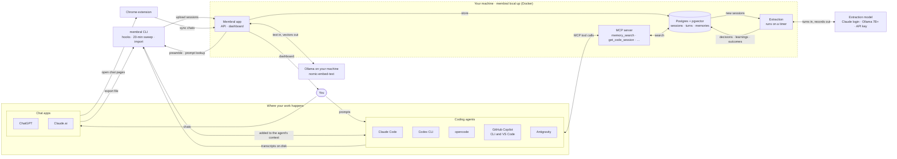

# Membral

Your coding agent can answer from what your past sessions found, including what nobody wrote down.

Membral saves your coding-agent sessions (Claude Code, Codex, opencode, Copilot, Antigravity) in one store on your
machine, extracts the decisions, learnings and outcomes, and lets your agents search them.

## How it fits together

**In.** The `membral` CLI reads each agent's transcripts from disk (end-of-session hooks and a 20-minute sweep) and
uploads them. Chats come in through the Chrome extension or an export file.

**Stored and processed.** The app keeps sessions, turns and memories in Postgres with pgvector. A timed job sends
new turns to an extraction model and stores the decisions, learnings and outcomes that come back. A local embedding
model turns text into vectors so search can compare meaning.

**Back to your agent.** Agents search over MCP. The CLI adds a preamble at session start and, in Claude Code,
matching records at each prompt. The dashboard shows everything stored.

## What it does

- One store for sessions from every agent, in one shape: turns, models, token usage, tools, files and sub-agents.
- Extracts decisions, learnings and outcomes, each with its quote and a link to the session.
- Searches by meaning, with keyword search as the fallback.
- MCP tools (`memory_search`, `memory_recall`, `get_code_session`) for any MCP-capable agent.
- A session-start preamble and, in Claude Code only, prompt-time lookup.
- ChatGPT and Claude.ai chats saved next to your coding sessions, and a dashboard to browse it all.

It is not live state: whether a PR is merged or what is deployed is checked in your forge. One store per person;
no team or admin controls yet.

## Run it locally

You need Node 22.5+ with Git, Docker with Compose 2.23+ (40 GiB of VM disk), [Ollama](https://ollama.com) for
embeddings, and one extraction model (step 3).

1. Install the CLI from a clone. This builds it and installs it globally:
   `git clone https://github.com/surajtripathy07/membral && cd membral && npm ci && npm run cli:install`
2. Pull the embedding model: `ollama pull nomic-embed-text`
3. Pick an extraction model by putting one choice in `~/.membral/local/.env` (`mkdir -p ~/.membral/local` first):
   - Claude subscription: `MEMBRAL_LLM_PROVIDER=claude-code` and `CLAUDE_CODE_OAUTH_TOKEN=<from claude setup-token>`
   - API key: `OPENAI_API_KEY=...` (or `OPENROUTER_API_KEY`)
   - Ollama: a 7B+ model such as `qwen2.5:7b`, run with `OLLAMA_CONTEXT_LENGTH=16384 ollama serve`
4. Start it: `membral local up --embeddings ollama`
5. Check it: `membral local status` (it prints an `Embeddings: ...` line).

`up` prints a sign-in URL and password and an API key; treat that output as a secret. The app is at
`http://localhost:3000`. The image is multi-arch (amd64 and arm64); if a pull fails, build it locally and pass `--image`. Image source builds, extraction setup, disk, logs, Linux notes and what works without an
extraction model are in [docs/SELF-HOSTING.md](docs/SELF-HOSTING.md).

## Why embeddings

Search compares meaning, so a question worded differently from the saved text still finds it. Without an embedder,
`memory_search` works on keywords only and says so ("SEARCH DEGRADED ... keyword-only results"), and the relevance
floor that drops weak matches is off. `nomic-embed-text` is the model whose thresholds are calibrated in this repo
(`apps/cloud/src/lib/memory/similarity.ts`). It runs on Ollama on your machine, so record text never leaves it.
Vectors are 1,536 wide, and smaller models are zero-padded. Chat and session-text search (`search_conversations`) is calibrated only for `text-embedding-3-small`, so with
`nomic-embed-text` it stays keyword-only and says so. The `claude-code` provider does no embeddings.

## Chrome extension

It syncs ChatGPT and Claude.ai chats to your local stack.

1. `npm run build --workspace=@membral/extension` (targets `http://localhost:3000`; for another port build with
   `VITE_CLOUD_URL=http://localhost:<port>`, or save a Server URL in the options page, where Chrome asks permission).
2. In `chrome://extensions`, turn on Developer mode, choose Load unpacked, pick `packages/extension/dist`.
3. In the options page, paste the API key `membral local up` printed (it starts `lls_`) and Save. The popup shows
   the server and "Connected with an API key".

## Supported agents

| Agent | Capture | Sync | MCP | Preamble |
|---|---|---|---|---|
| Claude Code | yes | yes | yes | yes |
| opencode | yes | yes | yes | yes |
| GitHub Copilot (CLI + VS Code Copilot Chat) | yes | yes | yes | yes |
| Codex CLI | yes | yes | yes | yes |
| Antigravity | yes | yes | yes | yes |

Capture reads the agent's transcripts. Sync is `membral sessions` plus the sweep. MCP is search by the agent. The
preamble is added at session start. The per-prompt lookup is Claude Code only. A Claude Code plugin is an
alternative to the CLI hooks ([docs/SELF-HOSTING.md](docs/SELF-HOSTING.md#claude-code-plugin)).

## Where your data goes

The local stack keeps everything on your machine. The exceptions are model calls: with an API key, session text
goes to that provider, and with a Claude login, to Anthropic through Claude Code. Saved: prompts, replies, tools
called, files touched and text written to files (capped). Tool output is not kept. Secrets are redacted by
pattern, and files such as `.env` keep no text. You choose which projects sync (`~/.membral/sync.json`).

## Commands

- `membral local up | status | logs <service> | down` runs the stack (`down --wipe` deletes the data).
- `membral setup`, `login` (default `http://localhost:3000`), `use`, `sessions`, `import <export.json>` and `status`.
- `membral --help` lists every command. `npm run smoke` checks the dashboard renders the fixtures.

## More

[docs/SELF-HOSTING.md](docs/SELF-HOSTING.md) covers the stack in depth. [CONTRIBUTING.md](CONTRIBUTING.md) goes
from clone to green gate to PR.

## License

MIT, see [LICENSE](LICENSE). Source: [github.com/surajtripathy07/membral](https://github.com/surajtripathy07/membral).
